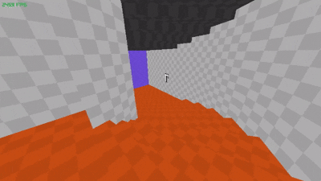
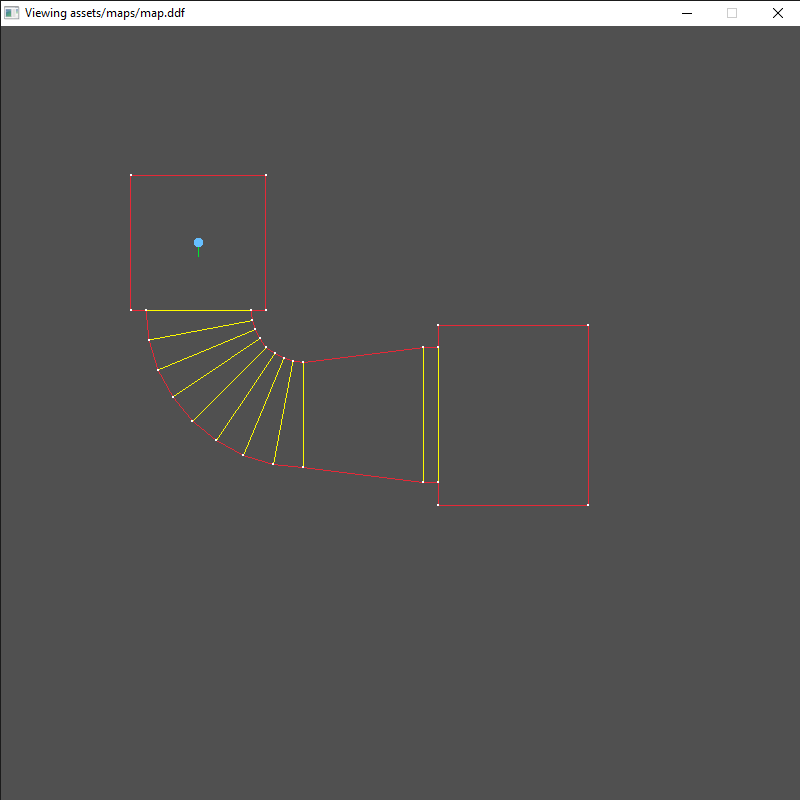

## About

A game I'm making which is heavily inspired
by Doom, And is aimed for the retro pixelated
look made with C and Raylib

### ~Features
Current features includes
  - map loading (.ddf file)
  - 3d character controller
  - interactable decals
  - sliding doors

### ~Demo

## Map editor
Addtionally I also wanted to make
a map editor but it's not complete
now, although you can view the map in 2d

